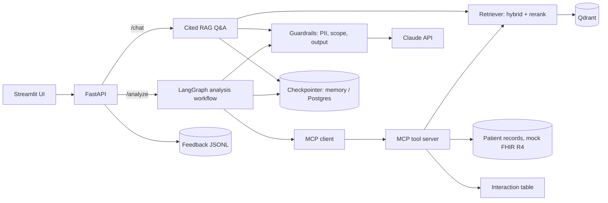
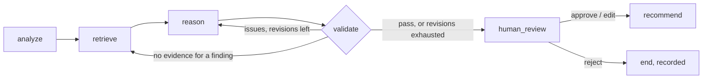
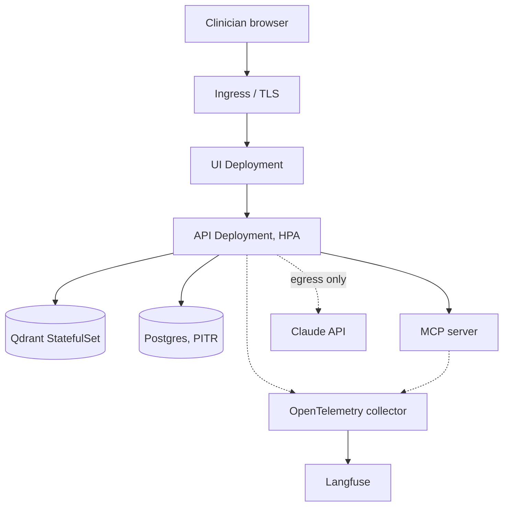

# Architecture

AI Clinician Copilot is clinical decision support. It answers guideline questions with citations and analyses a patient record into a prioritised, evidence-backed plan that a clinician approves before it is released. It never acts on its own: every patient-level output passes a human review gate. All patient data in this repository is synthetic.

> Status legend used below: **Built** = in the repository and covered by tests; **Planned** = Phase 6 design, not yet implemented.

## 1. System overview

| Layer | Package | Responsibility |
|---|---|---|
| Ingestion | `ingestion/` | PDF/DOCX loaders, section-aware chunker, idempotent indexer |
| Retrieval | `rag/` | Embeddings, Qdrant store, hybrid search, cross-encoder rerank, cited QA, chat memory |
| Agents | `agents/` | Patient model, deterministic rules and safety checks, LangGraph workflow |
| Tools | `mcp_server/` | MCP server and client; mock FHIR mapping |
| Safety | `guardrails/` | PII pseudonymisation, input scope, output checks |
| Interface | `api/`, `ui/` | FastAPI service, Streamlit app |
| Quality | `evaluation/`, `eval/` | Golden sets, metrics, LLM judge, scorecard, CI gate |

The design rule running through all layers: **the LLM proposes, deterministic code disposes.** Findings, drug-safety checks, citation validity and refusal thresholds are computed without a model; the LLM is used only to phrase answers and to synthesise recommendations, and its output is checked afterwards.

## 2. RAG pipeline

**Ingestion.** Documents are parsed (PyMuPDF, python-docx) and split by heading structure first, then by token budget (600 tokens, 100 overlap) so a chunk keeps its section path and page. Each chunk carries `doc_id`, title, page, section and a content hash; re-ingesting an unchanged file is a no-op and a changed file replaces its chunks.

**Query path.**

`question → rewrite → hybrid search (top 20) → cross-encoder rerank (top 5) → relevance gate → answer with [n] citations → citation check`

1. *Rewrite.* A low-effort LLM call turns a follow-up ("what about in CKD?") into a standalone query using the last 6 messages of thread history.
2. *Hybrid search.* Dense (`bge-small-en-v1.5`) and sparse (BM25) vectors are queried in Qdrant and fused with reciprocal rank fusion. Dense covers paraphrase; BM25 covers exact drug names, doses and abbreviations that embeddings blur.
3. *Rerank.* A cross-encoder (`ms-marco-MiniLM-L-6-v2`) rescores the 20 candidates against the query and keeps 5.
4. *Relevance gate.* If the best rerank score is below `MIN_RELEVANCE` (0.2) the system refuses *without calling the LLM*. This is the main defence against answering out of scope, and it costs nothing.
5. *Cited generation.* The model must cite sources by `[n]`. Citation IDs that match no retrieved source are dropped; if none remain the answer is refused as `uncited`. The response returns each citation's document, page, section, relevance score and quoted chunk, so a clinician can verify the claim at the source.

Refusals are typed (`low_evidence`, `insufficient_evidence`, `uncited`, `model_declined`) so the UI and the evaluation can distinguish them.

**Memory.** Conversation state lives in a LangGraph checkpointer keyed by `thread_id`: in-process for development, Postgres when `POSTGRES_URL` is set.

**Vector store.** Qdrant, chosen because it supports dense and sparse vectors and server-side RRF fusion in one collection, runs embedded for development and CI (no service needed), and scales out as a server or cluster behind the same client code (`QDRANT_URL`). Embeddings and reranking run locally via fastembed, so document text never leaves the deployment for indexing.

## 3. Agentic workflow

| Node | Kind | What it does |
|---|---|---|
| analyze | deterministic | Lab/vital thresholds (HbA1c, BP, eGFR and its trend, UACR, potassium, lipids) and medication checks produce severity-ranked findings |
| retrieve | RAG | One guideline query per finding through the reranking retriever (via MCP); sources de-duplicated and numbered |
| reason | LLM, structured output | Recommendations linked to finding IDs, each with citations and explicit medication changes, plus a monitoring plan |
| validate | deterministic | Re-checks the draft (below); failures loop back, up to `MAX_REVISIONS` |
| human_review | interrupt | Clinician approves, edits (edits are re-validated) or rejects |
| recommend | deterministic | Prioritised actions, monitoring, references, unresolved issues, confidence, disclaimer |

**Why a validator rather than a better prompt.** The LLM's draft is untrusted input. Validation checks that every citation points at a retrieved source; that each proposed drug change is safe against allergies (including class and ACE-inhibitor→ARB cross-reactivity), kidney function (metformin, SGLT2, sulfonylureas, RAAS agents with potassium) and high-severity interactions introduced by newly started drugs; and that every critical or high finding is addressed. Problems are fed back to the model as targeted instructions. If revisions run out, the draft still goes to the clinician, flagged with the unresolved issues, rather than being silently "fixed" or dropped.

**Durability.** The graph is checkpointed per `thread_id`. The human-review pause is a LangGraph interrupt, so a review can arrive minutes or days later and survive a restart (with the Postgres checkpointer). A failed run resumes from its last completed step (`POST /analyze/{id}/resume`) without re-running earlier LLM calls.

**Tool boundary (MCP).** Patients, guideline search and interaction checks are exposed as MCP tools (`get_patient_record`, `search_guidelines`, `check_drug_interaction`). The workflow talks to them through an MCP client, in-process by default or over stdio to a separate server. This keeps data access behind a narrow, auditable interface and lets the same tools serve external MCP clients. `get_patient_record` returns a mock FHIR R4 Bundle with LOINC-coded observations, which is the shape a real EHR integration would provide.

**Learning loop.** Edits and rejections are stored with the original and edited plan (JSONL), as are 👍/👎 and corrections on answers. This is the dataset for finding systematic gaps in rules and prompts; nothing is fine-tuned automatically.

## 4. Security, privacy and safety

| Control | Mechanism |
|---|---|
| PII minimisation | Names, contact details, NHS/SSN/MRN numbers, DOB and postcodes are replaced with stable placeholders before *every* LLM call and restored in the output. Presidio + spaCy NER unioned with regex recognisers. Clinical values and visit dates are kept because the reasoning needs them |
| Input scope | Prompt-injection attempts and first-person emergencies ("I have chest pain") are refused before any retrieval or LLM call, with a pointer to emergency services |
| Output | Sentences stating a dose without a citation are removed and reported in `guardrail_flags`; every answer and report carries a decision-support disclaimer |
| Grounding | Refusal below the relevance threshold; unverifiable citations dropped; refusal if none remain |
| Human in the loop | No patient recommendation is released without clinician action; edits are re-validated |
| Secrets | API keys come from environment variables (`pydantic-settings`), never committed |

Residual risks, stated plainly: pseudonymisation is best-effort (NER can miss an identifier in free text); safety thresholds follow a synthetic sample pathway and are *not* a validated clinical rule set; the interaction table is class-level, not a drug database. A production deployment would need a clinically governed rule set, a licensed interaction source, authentication/authorisation with per-patient access control and audit logging, and a regulatory assessment (this class of software is likely a medical device in many jurisdictions).

## 5. Evaluation

Evaluation is part of the build, not an afterthought; `uv run python eval/run_eval.py` writes a markdown scorecard.

| Suite | Measures |
|---|---|
| `agent` | Finding precision/recall, severity, safety-rule and interaction accuracy on 7 scenarios. Deterministic, no key needed |
| `retrieval` | Recall@K, Precision@K, MRR, hit rate; ablation of dense vs BM25 vs hybrid vs hybrid + rerank on a 30-question golden set |
| `generation` | Answer/refuse accuracy (8 of 30 items must be refused), key-fact coverage, citation validity, entity cross-check (numbers or drug names absent from sources); with `--judge`, claim-level faithfulness, citation accuracy, groundedness, hallucination rate, relevance |
| `agent_llm` | Full workflow per scenario: completion, validation pass rate, coverage of serious findings, first-pass rate |

Gold evidence is matched by `doc_id` + phrase rather than chunk ID, so the golden set survives re-chunking. CI runs lint, tests, indexes the sample pathway and gates on `eval/baseline.json`: any gated metric dropping more than 0.02 fails the build.

Limits: the golden set covers only the synthetic sample pathway, so retrieval numbers on real guidelines (WHO, KDIGO) are untested; the judge is a Claude model, so judged metrics are indicative rather than independent.

## 6. Scalability and deployment

**Built.** The API is stateless apart from the checkpointer, so replicas can be added freely once Postgres holds the checkpoints and Qdrant runs as a server. Embedding and reranking models are small CPU models loaded once per process. LLM latency dominates: a patient analysis is several sequential calls, which is why `analyze`/`retrieve` are deterministic or cheap and why failed runs resume rather than restart. Reasoning effort is configurable per step (`low` rewrite, `medium` answer, `high` reasoning).

**Planned (Phase 6).**

- **Containers and orchestration:** one image for API/MCP, one for UI; docker-compose for local (api, ui, qdrant, postgres, langfuse); Kubernetes for production with an HPA on the API, StatefulSets for Qdrant and Postgres, PodDisruptionBudgets, and secrets from a secret manager.
- **Network:** default-deny NetworkPolicies; only the API may reach Qdrant, Postgres and the MCP server, and only the API has egress (to the LLM provider).
- **Observability:** Langfuse tracing with per-node latency, token counts and cost; structured JSON logs carrying `thread_id`; OpenTelemetry spans across API → workflow → MCP → retrieval. Logs must never contain raw PHI, so the pseudonymised form is what is traced.
- **Disaster recovery:** Postgres point-in-time recovery for checkpoints and review state; scheduled Qdrant snapshots; and because the index is derived data, a documented re-ingest from versioned source documents as the fallback. Feedback JSONL moves to Postgres.

## 7. Technology choices

| Choice | Why | Trade-off |
|---|---|---|
| LangGraph | Explicit state machine, conditional loops, interrupts and checkpointing are exactly what a validate-and-review workflow needs | Another abstraction to learn; graph state must stay serialisable |
| Qdrant | Native dense + sparse + fusion, embedded mode for dev/CI, same client in production | One more stateful service to operate |
| Hybrid + cross-encoder rerank | Clinical text mixes paraphrase with exact tokens (drug names, doses); rerank gives a calibrated score for the refusal gate | Extra latency for the rerank pass; small models cap quality |
| Local embeddings (fastembed) | Indexing needs no external call; reproducible in CI | Lower ceiling than the largest hosted embedders |
| Claude via a thin `LLM` interface | Structured output and effort control; the protocol lets tests use a scripted fake, so the workflow is tested without network | Single provider dependency; mitigated by the interface |
| MCP for tools | Standard, narrow interface for data access; reusable by external clients | In-process default hides the boundary in dev |
| Deterministic rules plus LLM | Safety-critical checks are testable and auditable | Rules need clinical ownership and maintenance |
| FastAPI + Streamlit | Fast to build and demo; UI is a thin API client | Streamlit is not a production front end |
